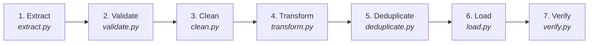

# BeatPulse — Music Recommendation & Listening Analytics System
### DBMS Capstone Project (Semester 3)

A full-stack relational database management system (DBMS) capstone project engineered with **MySQL 8.0+**, **Node.js (Express)** backend, and **Vite + React** frontend. It demonstrates normalized relational modeling, complex multi-table joins, subqueries, analytical SQL views, stored procedures, and event triggers for personalized music recommendation and listening telemetry.

---

## 🗄️ Database Architecture & DBMS Features

### 1. Relational Entities (3NF Normalized)
- **`users`** — User authentication, unique email/username, bcrypt password hashes, profile avatars.
- **`genres`** — Taxonomy lookup table with descriptions.
- **`artists`** — Catalog of musical artists with biographical data.
- **`songs`** — Core audio catalog with `artist_id` and `genre_id` foreign keys and indexed titles.
- **`playlists`** — User playlists with public/private status flags.
- **`playlist_songs`** — Relational Many-to-Many bridge table maintaining track sequence order (`position`).
- **`listening_history`** — Time-series telemetry logs capturing every listen event and duration.
- **`ratings`** — 1-to-5 star user evaluations with composite unique key constraints.
- **`user_preferences`** — Algorithmic genre preference weights maintained dynamically.

### 2. Analytical Database Views
- **`top_songs_view`** — Aggregates all-time play counts, distinct ratings, and average scores per song.
- **`genre_popularity_view`** — Groups song counts, cumulative plays, and mean rating per genre.
- **`user_analytics_view`** — Calculates listening hours, distinct song diversity, and total ratings per user.

### 3. Stored Procedures & Triggers
- **`sp_get_recommendations(user_id, limit)`** — Composite recommendation scoring formula:
  $$\text{Score} = (W_{\text{genre}} \times 2) + \bar{R}_{\text{song}} + \ln(1 + \text{Plays}_{\text{song}})$$
  excluding tracks already listened to frequently.
- **`sp_update_preferences(user_id)`** — Batch preference recalculation from listening logs and ratings.
- **`trg_after_listen`** — Trigger that automatically bumps genre affinity weights upon song playback.
- **`trg_after_rating`** — Trigger that adjusts genre weights proportionally when a user rates a track.

---

## 🚀 Quick Setup & Running Locally

### Prerequisites
- Node.js (v18+)
- MySQL Server (v8.0+) running locally on port 3306

### Step 1: Configure Backend Environment
Open `Backend/.env` and update your MySQL password if your local root user requires one:
```env
PORT=5000
DB_HOST=localhost
DB_PORT=3306
DB_USER=root
DB_PASSWORD=your_mysql_password
DB_NAME=music_analytics
JWT_SECRET=super_secret_jwt_key_music_capstone_2026
```

### Step 2: Initialize Database Schema & Seed Data
Run the automated initialization script from the `Backend` directory. This creates the database, all 9 tables, 3 views, 2 stored procedures, 2 triggers, 10 genres, 20 artists, 60 songs, 3 demo users, playlists, and sample listening history:
```bash
cd Backend
npm run init-db
```

### Step 3: Start the Backend Server
```bash
cd Backend
npm run dev
# API running at http://localhost:5000
```

### Step 4: Start the Frontend Application
In a separate terminal:
```bash
cd Frontend
npm run dev
# Frontend running at http://localhost:5173
```

---

## 👤 Pre-seeded Demo Accounts

| Username | Email | Password | Music Taste |
|---|---|---|---|
| `john_doe` | john@example.com | `password123` | Pop & Rock |
| `jane_smith` | jane@example.com | `password123` | Jazz & Classical |
| `music_lover` | music@example.com | `password123` | Electronic & Hip-Hop |

*(Instant one-click demo login buttons are also provided directly on the landing and sign-in pages)*

---

## 🎨 Design System & Color Tokens

- **Font**: Inter (no fallback fonts)
- **Background**: `#1B2A4A`
- **Surface/Card**: `#24345A`
- **Primary Accent**: `#E4A0A0`
- **Secondary Accent**: `#EED9A0`
- **Text (Main)**: `#FFFFFF`
- **Text (Muted)**: `#B8C2D9`
- **Danger**: `#EF4444`
- **Border Radius**: Consistent `8px` everywhere
- **No Gradients / No Random Shadows**: Clean flat tokens adhering strictly to project guidelines.

---

## 🧩 20 Standard Baseline Components Checklist

1. [x] **Dark Mode Toggle**: Persistent dark/light theme switch in header (`ThemeToggle`)
2. [x] **Simple Cookie Banner**: Dismissible consent banner with local storage persistence (`CookieBanner`)
3. [x] **Site Search**: Live catalog search in sticky header and song library (`SiteSearch`)
4. [x] **Back to Top Button**: Smooth scroll back to top button (`BackToTop`)
5. [x] **Mobile Menu**: Responsive slide-down navigation drawer (`Header`)
6. [x] **Loading Animations**: Clean loading spinners and skeletons (`LoadingSpinner`)
7. [x] **Hover States**: Consistent elevation and accent borders on interactive elements
8. [x] **Scroll Progress Bar**: Real-time reading/scroll indicator bar along the viewport top (`ScrollProgress`)
9. [x] **Copy Button**: One-click clipboard copy for song links, playlist URLs, and demo credentials (`CopyButton`)
10. [x] **Print Stylesheet**: Clean black-and-white `@media print` formatting for academic reports
11. [x] **Sticky Header**: Fixed navigation bar with glassmorphic blur and brand icon (`Header`)
12. [x] **Skip to Content Link**: Accessible keyboard navigation jump link (`.skip-link`)
13. [x] **Password Visibility Toggle**: Show/hide toggle on password inputs (`PasswordInput`)
14. [x] **UTM Tracking**: Inbound campaign parameter capture and session telemetry (`useUtmTracking`)
15. [x] **Form Success State**: Green/accent success confirmation notifications and alerts
16. [x] **Form Error State**: Clear error validation messages and server response banners
17. [x] **Confirmation Modals**: Dialogs for destructive actions like playlist or track deletion (`ConfirmModal`)
18. [x] **Last Updated Date**: Schema version and timestamp display in footer and profile (`LastUpdatedDate`)
19. [x] **Expandable FAQ**: Interactive accordion with schema explanations and algorithms (`ExpandableFAQ`)
20. [x] **Floating Contact Button**: Quick feedback modal for project evaluation (`FloatingContact`)

---

## 🔄 Data Pipeline, ETL Architecture & Ingestion Guide

The project features an enterprise-grade, memory-bounded Python ETL pipeline located in `pipeline/` designed to ingest, clean, deduplicate, and load high-volume telemetry datasets (such as the **Last.fm 1K user dataset** containing 19.1+ million scrobbles and 992 user profiles) without RAM exhaustion or primary key collisions.

### 1. 7-Stage Modular Architecture



1. **Extract (`pipeline/extract.py`)**:
   - Generator-based streaming for multi-gigabyte TSV files (`extract_listening_chunks`).
   - Processes records in memory-bounded batches (default: 50,000 rows/chunk).
   - Captures file origin and line numbers for full trace auditability.

2. **Validate (`pipeline/validate.py`)**:
   - Checks column counts, mandatory identifiers (`user_id`, `timestamp`, `artist_name`, `track_name`), and valid age bounds `[5, 120]`.
   - Distinguishes fatal malformations from optional missing fields (`album`, `duration`, `country`).
   - Logs rejected records with exact row numbers and diagnostic reasons to `data/cleaned/rejected_records.jsonl`.

3. **Clean (`pipeline/clean.py`)**:
   - **Text Normalization**: Unicode NFKC normalization, whitespace trimming, and unescaping HTML entities (`&amp;` &rarr; `&`).
   - **Sentinel Nulls**: Converts empty strings, `"null"`, `"None"`, `"\\N"`, and `"-"` to SQL `NULL` values. Never hallucinates default albums or durations.
   - **Date & Timestamp Parsing**: Converts varied date strings to `YYYY-MM-DD` and ISO-8601 UTC timestamps (`2009-04-15T18:32:00Z`) to MySQL-compatible `YYYY-MM-DD HH:MM:SS`.
   - **Multi-Artist Parsing**: Parses collaboration credits (`feat.`, `ft.`, `&`, `with`, `vs.`) into primary artist while preserving original catalog credit string.
   - **Track Titles**: Preserves live, acoustic, and remix designations (e.g. `(Live at Glastonbury)`) to prevent accidental destruction of distinct versions.

4. **Transform (`pipeline/transform.py`)**:
   - Converts raw records into strongly typed domain dataclasses: `UserEntity`, `ArtistEntity`, `GenreEntity`, `SongEntity`, and `ScrobbleEntity`.
   - Computes deterministic source ID hashes (`MD5(source_namespace:identifier)`) preventing cross-dataset key collisions.
   - Maps artist profiles to standard 10-genre taxonomy using keyword heuristics.

5. **Deduplicate (`pipeline/deduplicate.py`)**:
   - **Database Priming**: Pre-loads existing artists, songs, and users from the database into memory indexes on startup to prevent re-inserting records during repeated runs.
   - **Users**: Deduplicated strictly by canonical `user_id`.
   - **Artists**: Deduplicated by MusicBrainz ID (MBID) or normalized lowercase name; enriches existing records when MBIDs are discovered.
   - **Songs**: Deduplicated strictly scoped to `artist_id` via `(artist_id, track_mbid)` or `(artist_id, normalized_title)`. Songs sharing the same title across different artists (e.g., "Hello" by Adele vs Lionel Richie) are **never** merged.
   - **Scrobbles**: Deduplicated by composite key `(user_id, timestamp, song_id)`.

6. **Load (`pipeline/load.py`)**:
   - **Staging Isolation**: Batches records into isolated staging tables (`staging_users`, `staging_artists`, `staging_songs`, `staging_listening_history`).
   - **Transactional Merge**: Executes non-destructive `INSERT IGNORE` / `ON DUPLICATE KEY UPDATE` within single transactions (`BEGIN ... COMMIT`) with rollback on error.
   - **Dual Storage Engine**: Populates relational SQLite (`data/music_analytics.sqlite`), MySQL (via PyMySQL), and synchronizes with `Backend/db/importedData.json` for frontend mock store continuity.

7. **Verify (`pipeline/verify.py`)**:
   - Executes automated 12-point post-load audit checking foreign key references, uniqueness constraints, index coverage, view performance, and data quality score.

---

### 2. Dataset Configuration

Raw datasets are placed in `lastfm-dataset-1K/lastfm-dataset-1K/` or specified via environment variables in `pipeline/config.py`:

| Configuration Variable | Default Value | Description |
|---|---|---|
| `PROFILES_FILE` | `lastfm-dataset-1K/lastfm-dataset-1K/userid-profile.tsv` | User profiles TSV file path |
| `SCROBBLES_FILE` | `lastfm-dataset-1K/lastfm-dataset-1K/userid-timestamp-artid-artname-traid-traname.tsv` | Scrobbles (listening events) TSV file path |
| `CLEANED_DIR` | `data/cleaned/` | Directory for staged partitioned JSONL files |
| `SQLITE_DB_PATH` | `data/music_analytics.sqlite` | SQLite database file destination |
| `DEFAULT_CHUNK_SIZE`| `50000` | Stream generator batch buffer size |
| `DEV_ROW_LIMIT` | `50000` | Default development scrobble extraction limit |

---

### 3. Column Mapping Specification

#### A. User Profiles Mapping (`userid-profile.tsv`)
| Source TSV Column | Cleaned Intermediate Entity | Target Database Table & Column | Cleanup & Transformation |
|---|---|---|---|
| `#id` (e.g. `user_000001`) | `UserEntity.user_id` | `users.source_id` | Preserved as unique source identifier |
| `#id` | `UserEntity.username` | `users.username` | Generated unique username (`user_000001`) |
| `#id` | `UserEntity.email` | `users.email` | Deterministic email (`user_000001@lastfm.archive`) |
| `gender` (`m`/`f`) | `UserEntity.gender` | `users.gender` | Standardized to `'m'`, `'f'`, or `NULL` |
| `age` | `UserEntity.age` | `users.age` | Integer validated to range `[5, 120]`, else `NULL` |
| `country` | `UserEntity.country` | `users.country` | Normalized string, trimmed, or `NULL` |
| `registered` | `UserEntity.registered_at` | `users.created_at` | Parsed to standard `YYYY-MM-DD` |
| *(Source)* | `source_namespace` | `users.source_namespace` | Tagged as `'lastfm'` |

#### B. Scrobbles / Listening Events Mapping (`userid-...tsv`)
| Source TSV Column | Intermediate Entity | Target Database Table & Column | Cleanup & Transformation |
|---|---|---|---|
| `user_id` | `ScrobbleEntity.user_id` | `listening_history.user_id` | Foreign key resolved via user mapping |
| `timestamp` | `ScrobbleEntity.timestamp`| `listening_history.listened_at`| Converted from ISO-8601 UTC to `YYYY-MM-DD HH:MM:SS` |
| `musicbrainz_artist_id` | `ArtistEntity.mbid` | `artists.mbid` | Validated UUID string format or `NULL` |
| `artist_name` | `ArtistEntity.name` | `artists.name` | Unicode NFKC normalized, primary artist parsed |
| `musicbrainz_track_id` | `SongEntity.track_mbid` | `songs.track_mbid` | Validated UUID format or `NULL` |
| `track_name` | `SongEntity.title` | `songs.title` | Trimmed, unescaped, version brackets preserved |
| *(Calculated)* | `SongEntity.genre_id` | `songs.genre_id` | Inferred from artist keyword taxonomy |
| *(Calculated)* | `SongEntity.artist_id` | `songs.artist_id` | Foreign key resolved to deduplicated artist ID |
| *(Default)* | `duration_listened` | `listening_history.duration_listened` | Default `180` sec if absent |
| *(Source)* | `source_namespace` | `listening_history.source_namespace` | Tagged as `'lastfm'` |

---

### 4. Data Cleanup Rules Summary

1. **Zero Hallucinated Values**: Fields missing in the raw dataset (`album`, `duration_seconds`, `release_date`) are strictly stored as `NULL`. No dummy text (such as `"Unknown Album"` or `0000-00-00`) is fabricated.
2. **Sentinel Null Translations**: The values `""`, `"null"`, `"None"`, `"\\N"`, `"-"`, and `"undefined"` are converted to `None` / SQL `NULL`.
3. **Text Sanitization**: NFKC normalization converts compatibility characters, unescapes HTML tokens (`&quot;` &rarr; `"`, `&amp;` &rarr; `&`), and collapses redundant whitespace.
4. **Multi-Artist Handling**: Splits collaborations like `"David Bowie & Queen"` into primary artist `"David Bowie"`, collaborator `"Queen"`, and saves `"David Bowie & Queen"` in `original_credit`.
5. **Version Marker Preservation**: Strings such as `(Live at Wembley)`, `[2009 Remaster]`, and `(Acoustic)` are retained in song titles to prevent merging distinct performances.

---

### 5. Database Setup & Migration Procedure

#### Option A: SQLite (Default Standalone Mode)
The SQLite database requires no external server setup and is automatically initialized by the pipeline:
```bash
# Run ETL pipeline (initializes schema and loads 50,000 scrobbles)
python -m pipeline.run --limit 50000
```

#### Option B: MySQL 8.0+
1. Ensure MySQL is running on `localhost:3306`.
2. Configure credentials in `Backend/.env` (`DB_USER`, `DB_PASSWORD`, `DB_NAME=music_analytics`).
3. Run non-destructive schema migration:
```bash
cd Backend
npm run migrate
```
*(Executes `Backend/db/migrations/001_adapt_schema.sql` adding namespaces, staging tables, and indexes without dropping existing data).*

---

### 6. Re-Import & Idempotency Procedure

The pipeline is **100% idempotent** and safe to run multiple times:
- **Database Priming**: On every startup, `DeduplicationEngine` primes its in-memory lookups from the existing database. Previously imported entities are recognized, so primary keys are never re-assigned and identical scrobbles are skipped.
- **Incremental Loading**: You can run an initial 50,000 rows, then run 100,000 rows. The second run will seamlessly skip the first 50,000 and load the remainder.

#### Re-import Commands:
```bash
# 1. Development load (50,000 scrobbles)
python -m pipeline.run --limit 50000

# 2. Incremental expansion (extend to 100,000 scrobbles)
python -m pipeline.run --limit 100000

# 3. Full catalog import (all rows)
python -m pipeline.run --limit 0 --chunk-size 50000

# 4. Generate intermediate cleaned JSONL files without database writes
python -m pipeline.run --limit 50000 --export-cleaned-only

# 5. Run post-load verification audit only
python -m pipeline.run --verify-only

# 6. Run pipeline unit test suite
python -m unittest discover -s pipeline/tests -p "test_*.py" -v
```

